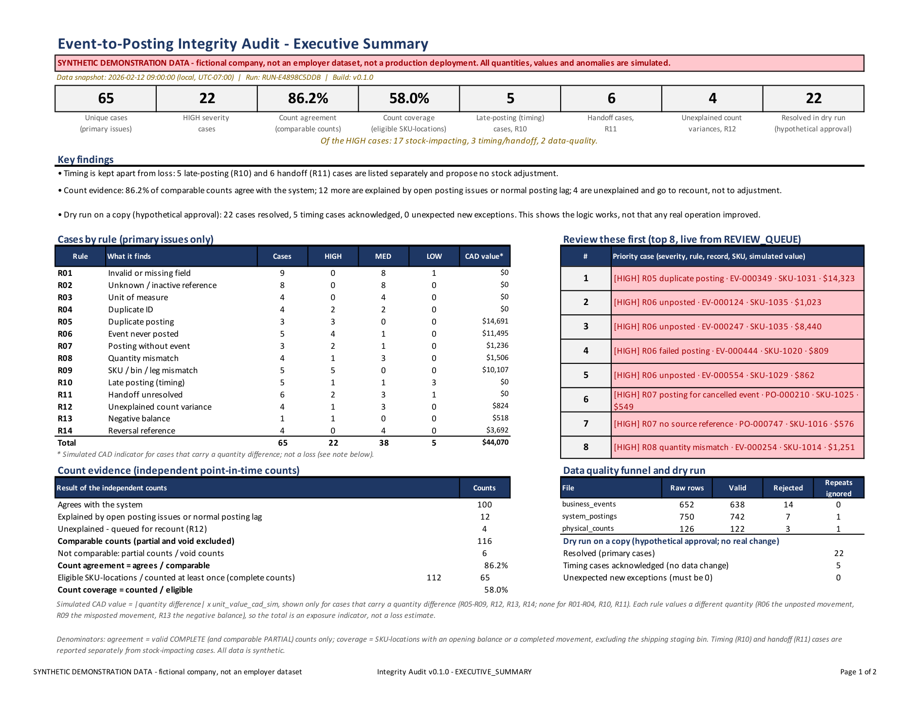

# Event-to-Posting Integrity Audit
**Cross-Shift Inventory Reconciliation & Data Quality Controls**

> **Synthetic-data portfolio project.** The company, items, quantities, anomalies and dollar values are generated. It is not an employer project, contains no real data and is not a production system.

**The question it answers:** *"The count doesn't match the system — what actually happened, how sure are we, and what should we review first?"*

The Integrity Audit compares three independent views of a multi-shift warehouse — the floor **event log**, the **ERP/WMS posting extract** and point-in-time **cycle counts** — and separates *timing around a shift cutoff* from *process or data defects* from *real count variances*. Every finding links back to the source file, record ID and CSV row. It never changes source data.



*The one-page Executive Summary of the demo workbook, as printed from Excel (synthetic data). The same page and the evidence-example page are in [`sample_output/Integrity_Audit_Print_Pack_2pages.pdf`](sample_output/Integrity_Audit_Print_Pack_2pages.pdf).*

## Results on the synthetic demo data
| | |
|---|---|
| Input | 652 events, 750 postings, 126 cycle counts (seeded, regenerable) |
| Issues found | 71 issues = **65 unique cases** (22 HIGH, 38 MEDIUM, 5 LOW); overlapping findings share one case and are never summed |
| Timing kept apart from loss | 5 late-posting and 6 cross-shift handoff cases, listed separately, no stock adjustment proposed |
| Count evidence | 116 comparable counts: 100 agree (**86.2%**), 12 are explained by open posting issues or normal posting lag, 4 are unexplained and go to recount; coverage 58.0% of eligible SKU-locations |
| Dry-run correction | on a copy, with a hypothetical approval: 22 cases resolved, 5 timing cases acknowledged, 0 unexpected new exceptions |
| Simulated exposure | about CAD 44,070 (absolute quantity difference × a *simulated* unit value) — an indicator, not a loss estimate |

All numbers come from `python -m stocktrace build --scenario demo`; `sample_output/` holds the files that build produces.

## A note on names
The public name of this project is **Event-to-Posting Integrity Audit**. The Python package and command line keep their original internal name `stocktrace` (so `import stocktrace` and `python -m stocktrace ...` work as shown below); it is not a product name.

## Quick start
```bash
python3 -m venv .venv
source .venv/bin/activate
python3 -m pip install -r requirements.txt
python -m stocktrace build --scenario demo --output output/demo   # workbook + CSV reports
python -m pytest -q                                               # 180 tests
python -m stocktrace sqlcheck --scenario demo                     # independent SQL cross-check (partial, see below)
```
Python 3.9 or newer. Open `output/demo/Integrity_Audit_Demo.xlsx` and start at `START_HERE`. An existing workbook that you modified is never overwritten without `--force`.

### Look at the workbook (about 5 minutes)
1. `EXECUTIVE_SUMMARY`: the eight tiles read 65 / 22 / 86.2% / 58.0% / 5 / 6 / 4 / 22.
2. `REVIEW_QUEUE`: filter `case_family` to `TIMING_PROCESS` (12 rows), or `severity` = HIGH and `primary_case` = Y (22 rows).
3. `EVIDENCE_EXAMPLE` shows one case (`EX-R08-EV-000254`) with both source records side by side; filter `EVIDENCE_DETAIL` on that `exception_id` to see the two rows, then open `data/raw/demo/business_events.csv` and `system_postings.csv` at the CSV rows it names.
4. To print the manager pack, select `EXECUTIVE_SUMMARY` and `EVIDENCE_EXAMPLE` and use *Print Active Sheets*: two landscape Letter pages.

## Use your own data
Provide **nine UTF-8 CSV files with a header row** in one folder and run:
```bash
python -m stocktrace build --input <folder> --output output/<name>
```
A missing file or missing column stops the run with a clear message; extra columns are ignored; a column named like a label (`anomaly`, `is_anomaly`, `ground_truth`, `planted`, `expected_issue`, `anomaly_type`) is rejected, so raw inputs can never carry the answers. Leading and trailing spaces in a cell are trimmed; nothing else is normalised. Bad rows are quarantined and reported (rules R01–R04) instead of being corrected.

| File | Required columns |
|---|---|
| `sku_master.csv` | `sku_id, description, base_uom, category, unit_value_cad_sim, count_tolerance_base, effective_from, effective_to` |
| `location_master.csv` | `location_id, zone, active_flag, effective_from, effective_to` |
| `uom_conversions.csv` | `sku_id, uom, to_base_factor` |
| `opening_balances.csv` | `timestamp, sku_id, location_id, quantity_in_base_uom` |
| `business_events.csv` | `event_id, event_timestamp, shift_id, event_type, sku_id, quantity, uom, from_location, to_location, status, related_id, handoff_to_shift, handoff_status` |
| `system_postings.csv` | `posting_id, source_event_id, system_post_timestamp, event_effective_timestamp, posting_type, sku_id, quantity, uom, from_location, to_location, posting_status, related_posting_id` |
| `physical_counts.csv` | `count_id, observed_at, sku_id, location_id, counted_qty, uom, count_status, evidence_ref` |
| `shifts.csv` | `shift_id, shift_name, start_ts, end_ts` |
| `rule_parameters.csv` | `key, value, description` (snapshot time and rule thresholds) |

Formats: timestamps are ISO-8601 **with an explicit offset** (`-07:00` or `Z`); quantities are plain unsigned decimals (`5`, `5.25`, `.5`) with no sign, thousands separator, unit or exponent; unit conversion happens only through `uom_conversions.csv`. Allowed values, column meanings and examples are in [`docs/DATA_DICTIONARY.md`](docs/DATA_DICTIONARY.md); the working example is `data/raw/demo/`.

## How it works, in one paragraph
Records are validated (R01–R04) and bad ones are quarantined. Each completed event is matched to its ERP postings by source ID and compared after unit-of-measure normalisation. Posting time is compared with the **event's own shift cutoff** (a posting exactly at the cutoff is timely): late is a timing case, never "missing stock". Counts are compared against two balances — system (by posting time) and event ledger (by event time) — so a count that matches the event ledger but not the system is *explained* by open posting issues instead of being booked as another loss. Root causes are hypotheses, review actions are proposals, and the correction simulation is a dry run on an in-memory copy. The 14 rules are in [`docs/RULE_CATALOG.md`](docs/RULE_CATALOG.md); the metrics in [`docs/KPI_DEFINITIONS.md`](docs/KPI_DEFINITIONS.md).

## How it is verified
* **180 automated tests**: a clean dataset that must raise nothing; a hand-written boundary fixture whose 30 expected issues and 9 count classifications were worked out by hand (cutoff ±1 second, UTC vs local time, zero vs blank, case vs each); sensitivity tests that inject one anomaly into the clean data; invariants (a transfer moves stock, it does not create it); a seeded generator whose planted anomalies are kept outside the raw inputs and are all found, with no false positives; an independent recomputation of every simulated CAD value; tests for spreadsheet formula injection and for the print layout.
* **Independent SQL cross-check — partial coverage.** `sql/` re-implements the logic in SQLite without importing any engine code. It covers **R01–R08, R10 (late postings only) and R12**, plus both balance calculations — **10 of the 14 rules**. R09, R11, R13, R14 and the other R10 variants are verified by the Python tests and the boundary fixture only. On the demo, clean and boundary scenarios the SQL and Python results agree: issue keys 47/47, 0/0 and 21/21, with every count balance equal.
* **Desktop Excel.** The workbook was opened and recalculated in Excel and the 2-page print pack was printed from Excel and checked page by page (the PDF in `sample_output/` is that print of the current workbook). The print layout of the longer list sheets was checked in a layout preview only, and a walkthrough of the evidence trail in Excel has not been done.

## Repository map
| Path | What |
|---|---|
| `stocktrace/` | rule engine, generator, workbook builder, simulation, SQL cross-check, CLI |
| `sql/` | runnable SQLite scripts (validation, matching, balances) |
| `config/rule_catalog.csv` | severity, owner role and review action per rule (editable) |
| `data/raw/demo/` | synthetic demo inputs, no labels |
| `data/fixtures/` | `clean/`, hand-written `boundary/` with expected results, and the generator's anomaly manifest |
| `sample_output/` | the workbook and CSV reports produced by the demo build, and the 2-page PDF |
| `tests/` | the pytest suite |
| `docs/` | [case study](docs/CASE_STUDY.md), spec, data dictionary, rule catalog, KPI definitions, process flow, scenario story, UAT results, limitations |
| `tools/` | boundary-fixture writer and an optional print-layout previewer |

## Limitations
Synthetic data only; no live ERP or WMS connection and no write-back; the simulation is a dry run; a fixed UTC-07:00 window (no daylight-saving change); SQL verification is partial (above); Power Query is not implemented; reversal of transfers, fuzzy matching and large volumes are out of scope. See [`docs/LIMITATIONS.md`](docs/LIMITATIONS.md).

## About this project
Developed with AI assistance (Claude Code). Every number in this repository can be regenerated with the commands above. No license has been chosen yet, so all rights are reserved until one is added.
